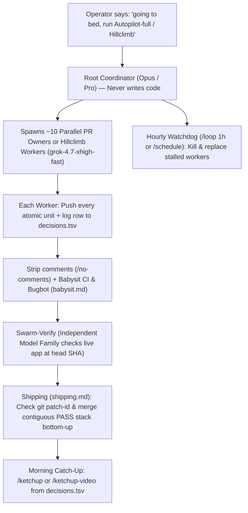

# 🥔🧑‍🦲🏭 Bald Potato Software Factory

Portable multi-agent installer for **Antigravity (`agy`)** 🚀, **Claude Code** 🤖, **Codex** 💻, **Cursor** ⚡, **OpenCode** 🛠️, and any Agentic Development Environment (ADE) 🌐.

Bundles **543 skills** 📚, **5 Antigravity plugins** 🔌, **always-on rules (`AGENTS.md` and `CLAUDE.md`)** 📜, and the `--bald-potato-degen-mode` CLI wrapper 🔥 into one repository.

## ⚡ Quick start

Clone this repository and run `./install.sh` on any macOS or Linux machine:

```bash
git clone https://github.com/tcxcx/bald-potato-software-factory.git
cd bald-potato-software-factory
./install.sh
```

## 🛠️ What `./install.sh` configures

1. 🚀 **Antigravity (`~/.gemini/config/plugins/` and `~/.gemini/config/skills/`)**
   - 🥔 `pstack` (`poteto-mode`, 61 skills, `poteto-agent`, `comment-sicko`, always-on `AGENTS.md` rule)
   - 🧑‍🦲 `mattpocock-skills` (`4ae2317`, 44 skills including `bald-potato` and `bald-potato-degen-mode`, `bald-potato` agent, `SessionStart` preload hook, always-on `AGENTS.md` rule)
   - 🛡️ `security-audit-skill` (Cloudflare `security-audit` skill and boundary-first `AGENTS.md` rule)
   - 🧪 `qa-skills` (`petrkindlmann/qa-skills`, 50 QA engineering skills, `qa.mjs` bounded runner, and `agent-result-gate.mjs` independent oracle wired as the Final-Instance QA Gate)
   - 🧰 `bald-potato-arsenal` (389 domain, motion, design, Vercel, video, cloud, behavioral, and marketing skills plus `AGENTS.md` index rule)
   - 🔥 Wraps `agy` so bare `agy`, `agy --bald-potato`, and `agy --bald-potato-degen-mode` always launch with `--dangerously-skip-permissions` and preload all four plugins.
2. 🤖 **Claude Code (`~/.claude/skills/` and `~/.claude/CLAUDE.md`)**
   - Installs all 493 skills and the combined Bald Potato Software Factory instructions.
3. 💻 **Codex (`~/.codex/skills/` and `~/.codex/AGENTS.md`)**
   - Installs all 493 skills and the combined `AGENTS.md` instructions.
4. 🌐 **Universal ADE paths (`~/.agents/skills/`, `~/.cursor/skills/`, `~/.config/opencode/skills/`, `~/skills/`)**
   - Syncs the full skill catalog for Cursor, OpenCode, Windsurf, Gemini CLI, and workspace discovery.

## 📦 Included skill suites

- 🥔 **Poteto Stack (`cursor/plugins/pstack`)**: `poteto-mode`, `architect`, `arena`, `swarm`, `interrogate`, `figure-it-out`, `show-me-your-work`, `blast-radius`, `statechart`, `unslop`, `technical-writing`, `no-comments`, and 22 engineering principles.
- 🧑‍🦲 **Matt Pocock Software Factory (`mattpocock/skills@4ae2317`)**: `software-factory`, `grill-me`, `grill-with-docs`, `domain-modeling`, `codebase-design`, `to-spec`, `to-tickets`, `implement-spec`, `tdd`, `code-review`, `diagnosing-bugs`, `wayfinder`, `retro`.
- 🛡️ **Cloudflare Security Audit (`cloudflare/security-audit-skill`)**: `security-audit` with 6-phase reconnaissance, hunting, and validation scripts.
- 🧠 **Behavioral & Strategic Analysis (`tcxcx`)**: `bucket-analysis`, `bucket-analysis-es`, `gateman-analysis`, `gateman-analysis-es`, `schiller-behavioral`, `cyber-kantics`.
- 🎞️ **Motion & Animation (`animations.dev` & `emilkowalski/skills`)**: `animate`, `css-animations`, `motion-react`, `improve-animations`, `review-animations`, `find-animation-opportunities`, `pick-ui-library`, `motion-brief`, `animation-vocabulary`, `animation-performance`, `animation-accessibility`, `gesture-ui`, `scroll-animations`, `debug-animation`, `animations-prototype`.
- 🏆 **Awwwards, Jury & UI/UX Design**: `awwwards` (`juliobsz/skills`), `awwwards-skill` (`SandroHub013/awwwards-skill`), `jury`, `frontend-design` (`anthropics/skills`), `ui-ux-pro-max` (`nextlevelbuilder/ui-ux-pro-max-skill`), `design-mobile-apps` (`designed-by-ai/skills`), `shadcn` (`shadcn-ui/ui`).
- ▲ **Vercel Official Ecosystem (`vercel` & `vercel-labs`)**: `find-skills`, `ai-sdk`, `next-bundle-optimizer`, `next-cache-components-adoption`, `turborepo`, `vercel-cli`, `deploy-to-vercel`, `vercel-react-best-practices`, `vercel-composition-patterns`, `ai-elements`, `json-render-shadcn`, `agent-browser`, `agent-desktop`, `workflow`, `chat-sdk`, `streamdown`, `flags-sdk`, `vercel-sandbox`, `portless`, `opensrc`, `before-and-after`, `create-remotion-geist`.
- 🎬 **Video, 3D & Generative Media**: `hyperframes-cli` + all 16 HeyGen Hyperframes skills (`heygen-com/hyperframes`), `remotion-best-practices` + all 13 Remotion skills (`remotion-dev/skills`), `higgsfield-generate` + all 9 Higgsfield skills (`higgsfield-ai/skills`).
- ☁️ **Cloud, Scraping, Productivity & Superpowers**: `supabase` (`supabase/agent-skills`), `google-agents-cli-adk-code` (`google/agents-cli`), `firecrawl` (`firecrawl/skills`), `ponytail` (`dietrichgebert/ponytail`), `brag` and `brag-slim` (`latent-spaces/brag`), `obra/superpowers`, `coreyhaines31/marketingskills`, `anthropics/skills`.

---

## 🐝 Multi-agent swarms with Grok Bot, Cursor, and Antigravity ADE

Both Cursor (`~/.cursor/skills/`) and Antigravity (`~/.gemini/config/plugins/` and `~/.agents/skills/`) load the same multi-agent orchestration skills from this repository.

### 1. Configure Grok and Opus model routing (`/setup-pstack`)

In Cursor chat, run `/setup-pstack` and pick `large (xhigh reasoning)` or `unlimited`. That writes `~/.cursor/rules/pstack-models.mdc`:

- **Grok worker pool (`grok-4.7-xhigh-fast`)**: Handles high-concurrency parallel execution (`swarm workers`, `feature`, `refactoring`, `bug-fix`, `perf-issue`, `hillclimb`, `how explorer`, `why investigators`).
- **Opus judgment pool (`claude-opus-5-5-xhigh`)**: Handles architecture synthesis and cross-family verification (`judgment and prose`, `hardest tasks`, `how explainer`, `why synthesizer`, `arena cross-judge pool`).
- **Paired bakeoff panels (`claude-opus-5-5-xhigh, grok-4.7-xhigh-fast`)**: Runs both models side by side for `arena runners`, `architect runners`, and `interrogate reviewers`.

In Antigravity (`agy`), `plugins/pstack/docs/harness/antigravity.md` maps Cursor's `Task` tool and `environment: "cloud"` to `invoke_subagent` with `TypeName: "self"` and `Workspace: "branch"` or `"share"`.

### 2. Four swarm topologies

| Topology | Command / Playbook | What it does |
| --- | --- | --- |
| **Coverage & Race Swarm** | `/swarm` (`plugins/pstack/skills/swarm/SKILL.md`) | Fans out `N` background workers across code slices or identical race arms (`first pass`, `rank all`, `best-of`) and aggregates `PASS`, `ISSUES`, or `BLOCKED` verdicts into one table. |
| **Multi-Model Bakeoff** | `/arena`, `/architect`, `/interrogate` | Spawns competing Grok and Opus implementations in isolated branches, cross-judges diffs with a model from another family, picks the base winner, and grafts the best ideas from the runner-up. |
| **Spec-to-Worktree Graph** | `/to-spec` -> `/to-tickets` -> `/implement-spec` | Converts a design into a dependency graph of vertical tracer-bullet tickets and dispatches parallel background implementer subagents across the unblocked ticket frontier on git worktrees. |
| **Standing Multi-PR Program** | `Orchestrate` (`plugins/pstack/skills/poteto-mode/playbooks/orchestrate.md`) | One coordinator chat keeps ~10 cloud workers in flight (`one owner per PR` + `one cross-model verifier per PR`) without writing code in the root context window. |

### 3. Wake Grok Bot from Webhooks, Tailscale UIs, or Slack

- **Custom Webhook UI (`/make-bot-ui`)**: Run `/make-bot-ui` in Cursor (`plugins/pstack/skills/make-bot-ui/SKILL.md`) to create a webhook routine (`trigger: { "type": "webhook" }`). Open **Routines** (`Cmd+Shift+I`), copy the `https://api2.cursor.sh/automations/webhook/<id>` URL and sender key, and let `/make-bot-ui` bind a local trigger server on `0.0.0.0:<port>` (exposed over Tailscale) that wakes Grok Bot with JSON payloads.
- **Slack Issue Triage & Repro Bot (`benny`)**: Point Cursor at `plugins/pstack/automations/benny/FOR_AGENTS.md` to install the two `benny` Cursor Automations into `.cursor/automations/benny/`. Automation 1 triages new Slack reports; Automation 2 reproduces confirmed bugs through the real UI, builds a TDD fix, and opens a draft PR.
- **Headless `agy` Worktree Workers from Cursor**: Because `agy` runs with `--bald-potato-degen-mode` (`--dangerously-skip-permissions`) by default, any script or coordinator can fan out headless `agy` workers across git worktrees in parallel:

```bash
git worktree add ../wt-slice-1 -b feat/slice-1
(cd ../wt-slice-1 && agy -p "Implement slice 1 per SPEC.md using /tdd and commit to feat/slice-1") &
```

---

## 🌙 Running autonomous fleets while you sleep (Poteto's overnight loop)

This repository includes the exact `pstack` playbooks designed to push hundreds or thousands of verified commits and stacked PRs unattended overnight without context collapse or unreviewed regressions.



### Why the overnight loop scales without shipping broken code

1. **The sleep override (`"going to bed"`, `"run until done"`, `/goal`)**:
   Saying `"going to bed"` or `"be fully autonomous"` activates full autonomy in `poteto-mode`, forbids `AskQuestion` on reversible choices (`principle-never-block-on-the-human`), and commits a `decisions.tsv` audit log via `show-me-your-work`.
2. **"Assume the VM dies" atomic commit cadence (`Autopilot-full` & `Hillclimb`)**:
   - In **`Autopilot-full`** (`plugins/pstack/skills/poteto-mode/playbooks/autopilot-full.md`) and **`Autopilot-stack`** (`autopilot-stack.md`), every PR owner sequences work into small verifiable units (`principle-sequence-verifiable-units`), pushes each unit to its branch before starting the next, runs `/no-comments`, and drives CI and Bugbot to green (`babysit.md`).
   - In **`Hillclimb`** (`plugins/pstack/skills/poteto-mode/playbooks/hillclimb.md`), the coordinator freezes a benchmark harness (`principle-build-the-lever`), fans out hypotheses to `grok-4.7-xhigh-fast` subagents in separate worktrees, commits one atomic commit per measured win that clears noise, reverts everything else, and logs every attempt to `decision.tsv`.
3. **Cross-model verification swarm & bottom-up shipping (`shipping.md`)**:
   An author agent can never approve its own PR, and green CI alone never triggers a merge. A separate verifier swarm from a different model family must run the real app at the head SHA and post `PASS`. Then `shipping.md` walks the stack bottom-up, checks `git patch-id` across rebases so verdicts survive clean restacks, and merges only the contiguous verified run.
4. **Hourly drift & stall watchdog (`/loop 1h` / `/schedule`)**:
   Step 6 of `autopilot-full.md` arms an hourly heartbeat (`/loop 1h` in Cursor, or `/schedule` and `/goal` in Antigravity). Every tick inspects each subagent's actual git pushes and `decisions.tsv` rows against its `stuck-after` runtime, kills stalled workers immediately, and spawns fresh replacements.
5. **Morning briefing (`/ketchup` and `/ketchup-video`)**:
   When you wake up, run `/ketchup` (or `/ketchup-video` for a subtitled slide video) to review every PR that landed, every reverted experiment, and any operator-gated decisions waiting on you.

### Prompt to launch an overnight run

```text
Going to bed. Be fully autonomous. Run the Autopilot-stack playbook (or Hillclimb playbook) on [target spec / queue / metric]. Arm a 1h watchdog loop, log every unit to decisions.tsv via show-me-your-work, and do not stop until the exit predicate holds.
```
